# NYC Yellow Taxi 2026 — Databricks · Delta Lake · SQL · PySpark · Medallion Architecture

## Overview

End-to-end data engineering and analytics project on NYC Yellow Taxi trip records
(January–May 2026) using a full medallion architecture (Bronze → Silver → Gold)
on Databricks. Raw Parquet files are ingested into Delta tables, deduplicated,
cleaned and enriched in Silver, and aggregated into thirteen analytical Gold
tables (nine analyses) that power an interactive Databricks dashboard.

The project covers the complete data lifecycle: ingestion, quality profiling,
cleaning, analytical modelling and visualisation. Every analysis is written
twice — in SQL and as PySpark DataFrame code — and each PySpark result is
automatically compared with its SQL counterpart before it is saved.

**Dataset:** NYC Taxi and Limousine Commission (TLC) — Yellow Taxi Trip Records  
**Source:** [TLC Trip Record Data](https://www.nyc.gov/site/tlc/about/tlc-trip-record-data.page)  
**Period:** January–May 2026 · 15 trips with pickup dates outside the period (earliest 2001-01-01, latest a single June 2026 trip) excluded  
**Scale:** ~19.0M raw trips in Bronze → ~12.25M trips after cleaning (about 64% retained) · $380.6M total revenue

---

## Objectives

- Implement a production-style medallion architecture (Bronze / Silver / Gold) on Databricks Unity Catalog
- Apply explicit data quality rules in Silver, each backed by a profiling query: duplicates, invalid amounts and passenger counts, impossible durations and speeds, and timestamps outside the reporting period
- Build thirteen Gold analytical Delta tables covering trip efficiency, fare breakdown, surge detection, geographic corridors, airport analysis, congestion pricing, vendor comparison and monthly trends
- Implement each analysis in both SQL and PySpark, and verify that the two agree
- Deliver findings through an interactive multi-page Databricks dashboard

---

## Tools & Technologies

| Tool | Purpose |
|---|---|
| Databricks (serverless, Spark 3.5+) | Unified platform — notebooks, Unity Catalog, Delta Lake, dashboard |
| Apache Spark (PySpark DataFrame API) | Distributed processing; the second implementation of every analysis |
| Delta Lake | ACID-compliant storage with time travel and versioning |
| SQL (Databricks SQL / Spark SQL) | Bronze exploration, Silver cleaning, Gold analytical tables |
| Python | Ingestion, helper functions, SQL-vs-PySpark comparison |
| Unity Catalog | Three-tier namespace: `taxi.taxi_bronze / taxi_silver / taxi_gold` |

---

## Medallion Architecture

```
Source (NYC TLC: 5 monthly Parquet files + zone lookup CSV)
      │
      ▼
BRONZE — raw ingestion, no transformations
  · yellow_taxi_trip_raw_data      (~19.0M rows, 5 Parquet files)
  · yellow_taxi_lookup_raw_data    (265 rows, zone reference)
      │
      ▼
SILVER — deduplicated, cleaned and enriched (~12.25M rows)
  Tables: yellow_taxi_trips_deduplicated · yellow_taxi_trips_cleaned
          (built in SQL; yellow_taxi_trips_cleaned_pyspark is the PySpark twin)

  Removed:
    · Duplicate trips (same pickup/drop-off time, zones and total_amount)
    · Negative fare, total amount or distance
    · Passenger count NULL or outside 1–6
    · Drop-off not after pickup; duration outside 5–200 minutes
    · Average speed above 100 mph (recorded distances up to 98,773 miles)
    · Pickup outside January–May 2026 (15 trips, dated from 2001 to June 2026)
    · Columns: store_and_fwd_flag, mta_tax, improvement_surcharge

  Added (14 derived columns):
    · vendorid_label, rate_type, payment_type_label
    · pickup_/dropoff_ hour, day_of_week, month
    · trip_duration_mins, avg_speed_mph
    · tip_pct (credit card only)
    · trip_type (airport / standard), congestion_zone_flag
      │
      ▼
GOLD — 13 analytical Delta tables, the serving layer for the dashboard
```

---

## Analyses (Gold Tables)

| # | Table | Description |
|---|---|---|
| 1 | `trip_duration_speed_analysis` | Trip share, average speed, fare per minute and revenue by duration bucket (5–15, 15–30, 30–45, 45+ min) |
| 2 | `fare_components_breakdown` | Share of total amount per fare component, by payment type |
| 3a | `surge_detection_general` | Trip count, average fare, tip rate and revenue for every day-of-week × hour combination |
| 3b | `surge_detection` | Top 5 day × hour combinations by total revenue |
| 4 | `top_pickup_dropoff_zones` | Zones in the top 10 for both pickup and drop-off volume |
| 5a | `zone_to_zone_frequency` | Top 20 most frequent pickup → drop-off corridors (min. 20 trips) |
| 5b | `zone_to_zone_profitability` | Top 20 most profitable corridors by fare per minute (min. 20 trips) |
| 6a | `trip_type_analysis` | Airport vs standard trip comparison |
| 6b | `trip_type_in_depth_analysis` | Top 15 pickup zones for airport trips |
| 7a | `congestion_impact_by_corridor` | Congestion-zone vs standard trips by borough corridor |
| 7b | `congestion_impact_monthly` | Monthly trend per congestion flag, with month-over-month change in trip count |
| 8 | `vendor_performance` | Vendor comparison — fares, tips, cash vs card split |
| 9 | `monthly_trend_analysis` | Month-over-month change across all key metrics |

---

## Key Findings

- **Airport trips generate 3.3× higher average fares** ($56.75 vs $17.16) despite representing only 10.2% of total trips — and account for about 26% of all tip revenue
- **Early morning produces the highest average revenue per trip** — $42.41 at 5am and $37.15 at 4am, against about $30 around midday (11am–noon) — a pattern consistent with more airport and long-distance trips at those hours (not tested separately here)
- **Queens → airport corridors dominate profitability rankings** — the top five corridors by fare per minute all start in Queens and end at JFK or LaGuardia; South Ozone Park → JFK generates $10.38/minute over 1,080 trips, the highest of any corridor with at least 20 trips
- **Curb Mobility handles 77.8% of trips (3.5× Creative Mobile Technologies)** with a lower average fare ($20.88 vs $22.31, $1.43 less) on shorter trips (3.56 vs 4.42 miles) — yet its average total amount per trip is higher ($31.28 vs $30.39), and its passengers tip nearly 5 percentage points more on credit card payments (24.7% vs 19.8%)
- **Total revenue grew 25.8%** from $68.75M in January to $86.50M in May, driven by both volume growth (+23%) and modest fare increases (+2.9%)
- **Congestion-zone trips grew 25% from January to May 2026, against 17% for standard trips.** This is a comparison between charged and uncharged trips only: the fee has been in force since January 2025, so the data contains no pre-fee baseline and cannot show whether congestion pricing changed demand
- **VendorID 6 (Myle) and VendorID 7 (Helix) are absent from Silver and Gold.** Myle reports no `passenger_count` (NULL on all 36,577 trips) and Helix reports identical pickup and drop-off times (zero duration on all 234,756 trips), so every trip fails a Silver rule

---

## Data Quality Decisions

Each rule is backed by a profiling query in the notebook (a one-row violation count after deduplication, plus the speed-outlier analysis). Silver keeps about 64% of the Bronze rows (12.25M of 19.0M). The rules overlap, so the counts in the table below do not add up to the 6.75M rows removed; missing passenger counts are by far the largest single cause.

| Issue | Rows affected (deduplicated Bronze, 18,999,278 rows) | Decision |
|---|---|---|
| Duplicate trips (same pickup, drop-off, zones and total amount) | 4 duplicates (18,999,282 → 18,999,278) | One copy kept; the SQL tie-break is `ORDER BY VendorID` |
| `passenger_count` NULL | 4,812,280 (25% of rows) | Removed in Silver |
| `passenger_count` outside 1–6 | 64,885 | Removed in Silver |
| Negative fare or total amount | 118,396 (no negative distances) | Removed in Silver |
| Drop-off not after pickup | 236,375 (234,756 of them Helix) | Removed in Silver |
| Trip duration outside 5–200 min (includes the row above) | 1,960,221 | Removed in Silver |
| Average speed > 100 mph (distances up to 98,773 miles; 166 trips above 200 mph) | 4,027 | Removed in Silver — recording errors |
| Pickup outside January–May 2026 (earliest 2001-01-01; one trip dated June 2026 in the May file) | 15 | Removed in Silver; kept in Bronze |
| Zero distance / zero total amount | 576,744 / 2,699 | Kept (rules only reject negative values) — see Limitations |
| `mta_tax` and `improvement_surcharge` — inconsistent values, e.g. `mta_tax` from −$0.50 to $10.50 | Columns dropped; `total_amount` is used for revenue |
| RatecodeID = 99 or NULL | Kept, labelled `unknown` |
| `payment_type` = 0 (Flex Fare) | Kept, labelled `flex_fare_trip` |
| VendorID 6 and 7 — valid vendors, no clean records | Kept in Bronze, absent from Silver and Gold (see Limitations) |
| Single-trip noise in corridor rankings | Minimum 20 trips per corridor |

---

## Limitations

- **Congestion pricing:** the data covers January–May 2026 only, after the fee started (January 2025). The analysis compares charged and uncharged trips; it cannot measure the effect of the policy.
- **Vendors:** only Creative Mobile Technologies and Curb Mobility appear in the vendor comparison. Helix's 234,756 trips are otherwise valid (fare, distance, zones) and are excluded only because their duration is always zero, since Silver and several Gold tables depend on duration.
- **Missing passenger counts:** 4.81M trips (25% of the raw data) have a NULL `passenger_count` and are removed because Silver requires a value between 1 and 6. Most analyses do not use passenger count, so this rule is stricter than most of them need.
- **Zero-distance trips:** 576,744 trips with zero distance are kept; they may include cancelled rides and pull down average distance and speed.
- **Tips:** cash tips are not recorded, so all tip metrics are based on credit-card trips only.
- **Revenue components:** `total_amount` does not equal the sum of the remaining components, because `mta_tax` and `improvement_surcharge` are excluded.
- **Time window:** five months cannot show seasonality, and month-over-month changes are partly seasonal.
- **SQL dialect:** the SQL uses Databricks / Spark SQL syntax (for example `COUNT_IF`, `SELECT * EXCEPT (...)`) and is not portable to MySQL or PostgreSQL without changes.

---

## Dashboard

Built on the Databricks native dashboard — 8 pages querying the Gold Delta tables directly.

| Page | Content |
|---|---|
| Overview | 6 KPI cards — total trips, revenue, avg fare, avg distance, avg duration, avg tips |
| Monthly Trend | Trip and revenue line charts, MoM % change, avg fare trend |
| Trip Duration & Surge | Duration bucket analysis, fare/min efficiency, hourly heatmap |
| Geography | Frequency and profitability corridor tables, busiest interchange zones |
| Fare & Payment | Revenue and trip share by payment type, fare component breakdown |
| Vendors Analysis | Trip volume, fares, tips, cash vs card split by vendor |
| Airport Analysis | Airport vs standard comparison, top 15 pickup zones, tip revenue share |
| Congestion Analysis | Congestion zone vs standard monthly trends |

### Screenshots

#### Overview
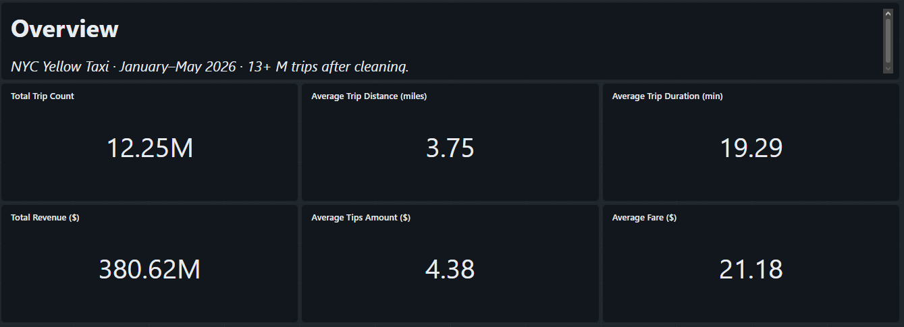

#### Monthly Trend
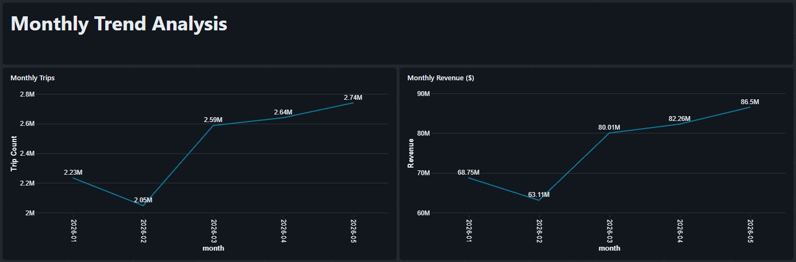
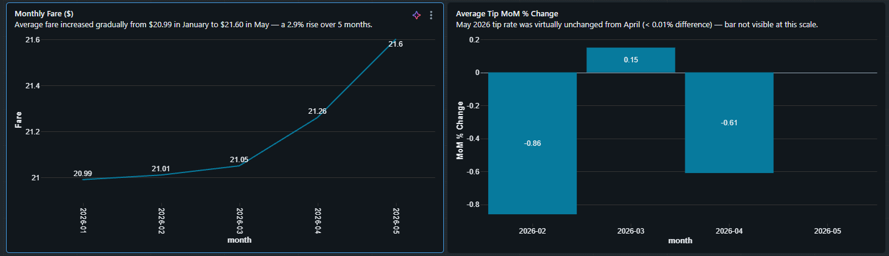
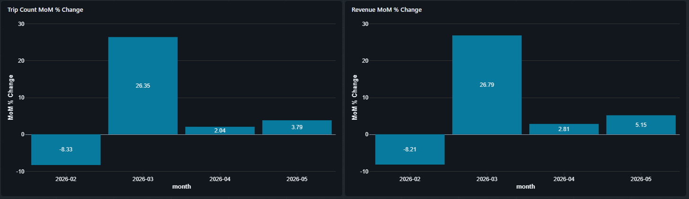

#### Trip Duration & Surge
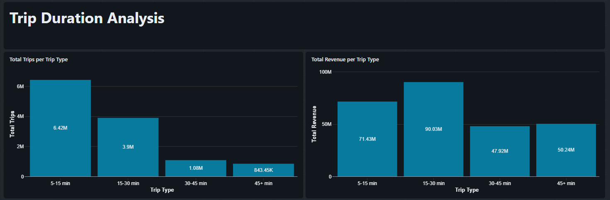
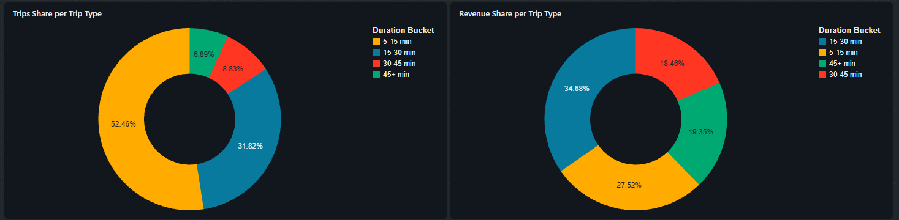
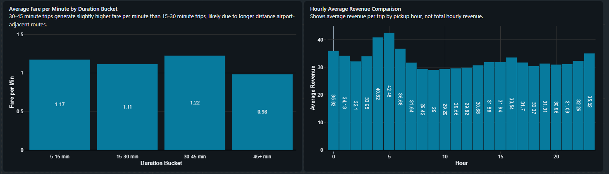
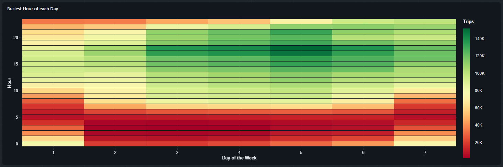

#### Geography
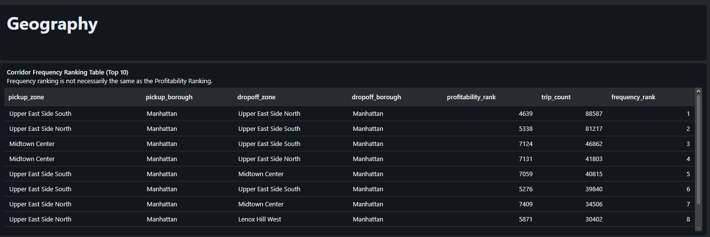
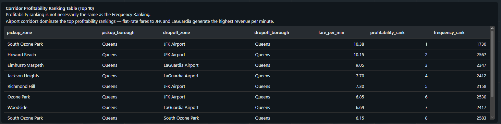
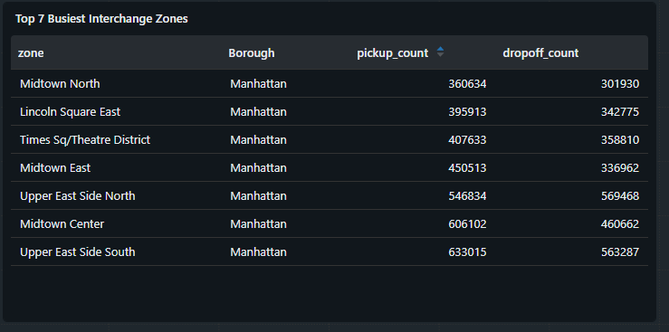

#### Fare & Payment
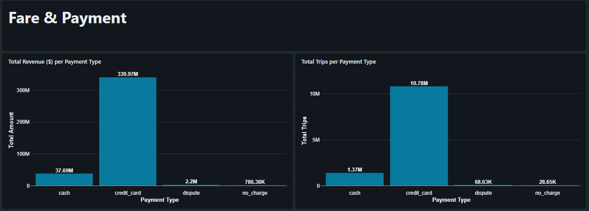
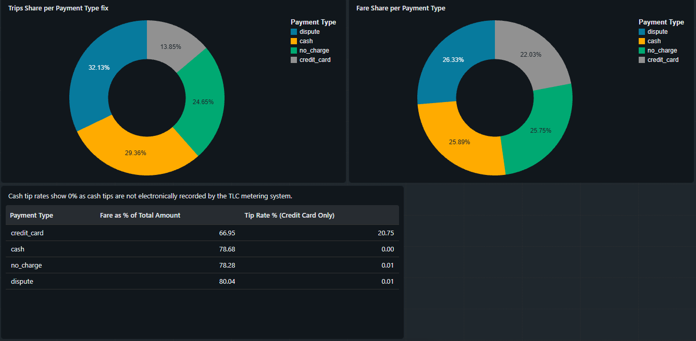

#### Vendors Analysis
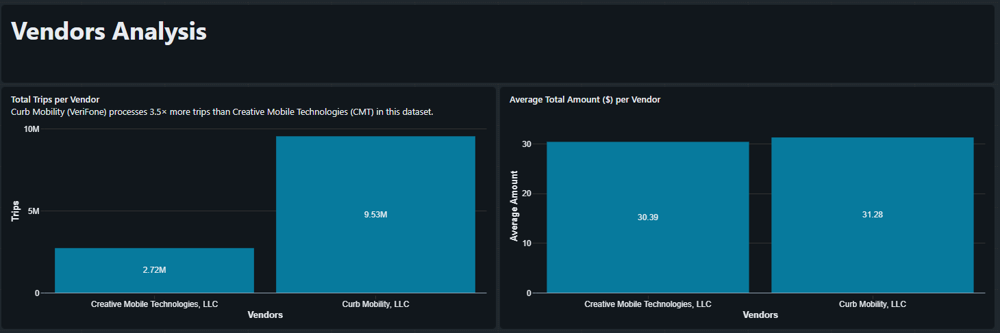
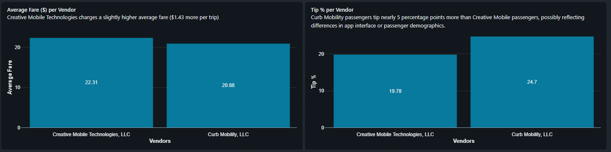
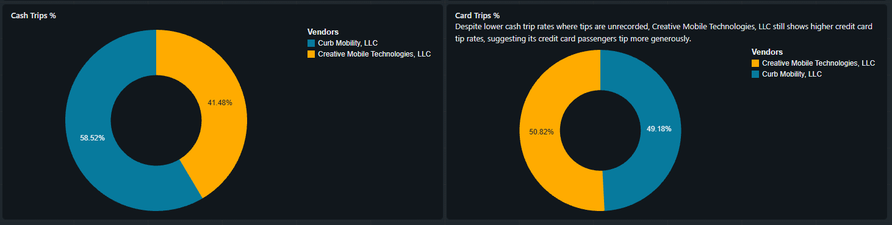

#### Airport Analysis
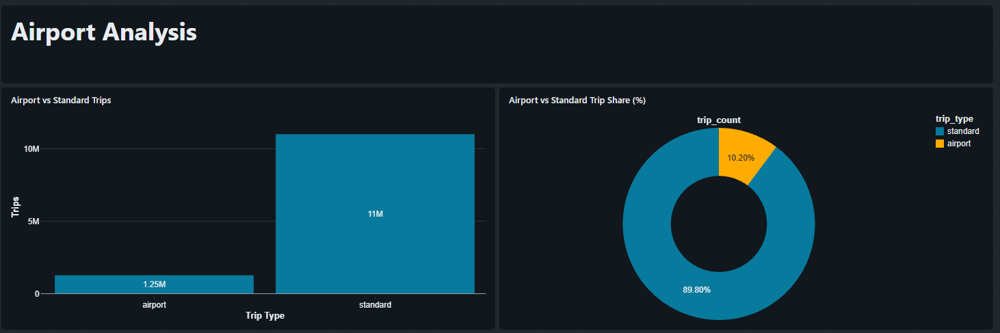
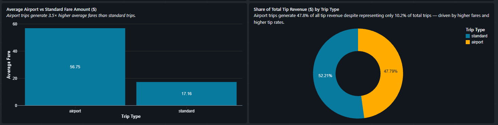
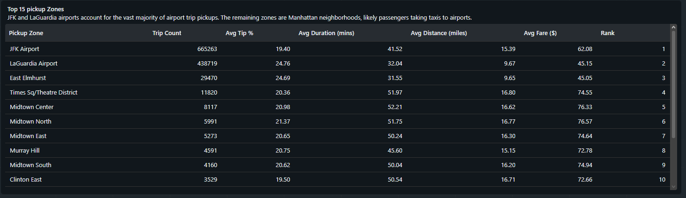

#### Congestion Analysis
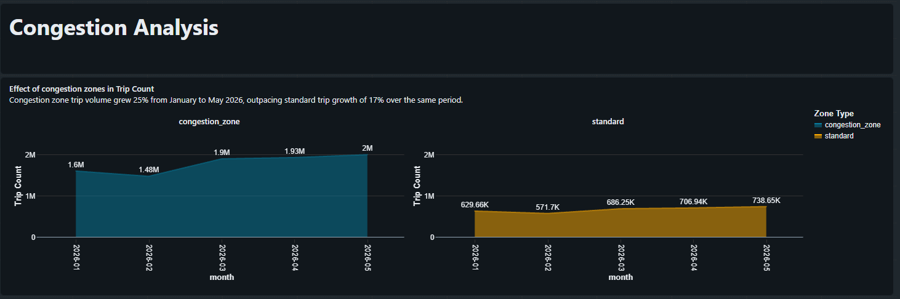
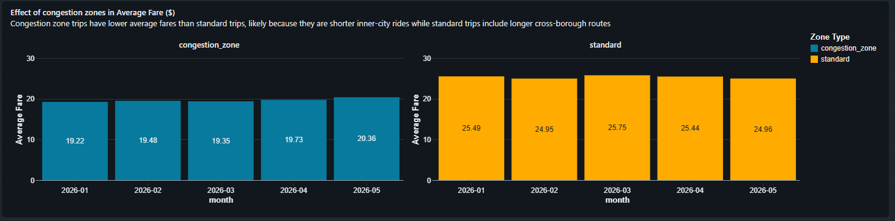
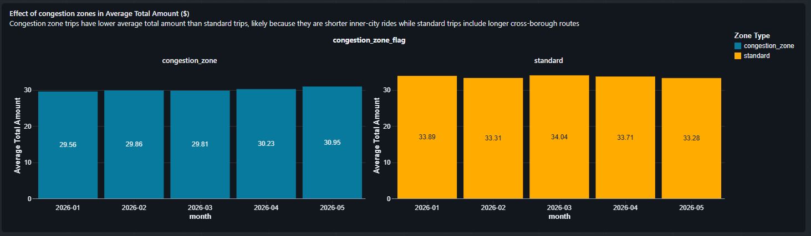

---

## Project Structure

```
nyc-yellow-taxi-2026/
├── README.md
├── notebook/
│   └── Taxi_dataset.ipynb                       # Full Databricks notebook — Bronze to Gold
├── Dashboard/
│   └── Screenshots/                             # Dashboard page screenshots
└── data/
    ├── data_dictionary_trip_records_yellow.pdf  # Official TLC data dictionary
    ├── taxi_zone_lookup.csv                     # TLC zone reference table (265 rows)
    └── *.parquet                                # 5 monthly Yellow Taxi files, Jan–May 2026
```

---

## How to Run

1. Use a Databricks workspace with Unity Catalog and serverless compute (or Databricks Runtime 14.0+, Spark 3.5+).
2. Create the catalog `taxi` and the schemas `taxi_bronze`, `taxi_silver` and `taxi_gold`. The notebook does not create them.
3. Upload the 5 monthly Parquet files and `taxi_zone_lookup.csv` to Volumes in the Bronze schema:
   - `/Volumes/taxi/taxi_bronze/yellow_taxi_trip_data` — the Parquet files
   - `/Volumes/taxi/taxi_bronze/taxi_zone_lookup` — the lookup CSV
4. Open `Taxi_dataset.ipynb`, attach compute, and run all cells top to bottom (or Restart and Run All). Bronze → Silver → Gold build in order.
5. Check the verification output: the `compare_with_sql_table` lines print `0` and `0` for all 13 Gold tables, and the Silver quality checks report no remaining violations.
6. Open Databricks Dashboards and connect each widget to the corresponding Gold table.

Two cells create temporary views (`speed_research` and `corridor_zones`). They last only for the session, so rerun them after a restart.
